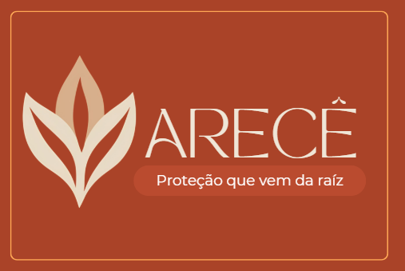

# Arecê — Website Institucional 🌿

  

  <b>Essência que encanta, proteção que te acompanha</b>
   
  Ciência, biodiversidade brasileira e inovação em uma experiência de autocuidado

  <a href="https://arece.lovable.app">Website</a> •
  <a href="https://instagram.com/arece_cosmeticos">Instagram</a>

---

## Sobre o projeto 🍃

O **Arecê Website** é o site institucional da Arecê, uma iniciativa que conecta ciência, natureza e inovação para desenvolver soluções de autocuidado inspiradas na biodiversidade brasileira.

A plataforma foi desenvolvida para apresentar a identidade da marca, compartilhar a proposta do produto, comunicar seus diferenciais e aproximar a Arecê de consumidores, parceiros e investidores.

O principal produto apresentado é um perfume sólido de proposta multifuncional, desenvolvido com inspiração na biodiversidade brasileira e com óleo de copaíba como ativo de interesse para a pesquisa de propriedades repelentes.

Mais do que apresentar um produto, o website comunica o propósito da Arecê: transformar pesquisa científica em soluções que valorizem a saúde pública, a sustentabilidade e o uso responsável dos recursos naturais.

## Objetivos

- Apresentar a identidade, o propósito e o posicionamento da Arecê.
- Comunicar a proposta e as características do perfume sólido.
- Compartilhar os diferenciais da iniciativa.
- Divulgar a missão, visão e valores institucionais.
- Apresentar os integrantes e as responsabilidades da equipe.
- Criar canais de comunicação com consumidores e investidores.
- Conectar o público à iniciativa educacional Arecê for Kids.

## Funcionalidades

### 1. Apresentação institucional

A seção inicial apresenta a marca, sua identidade visual e sua proposta de valor, com chamadas para ações importantes.

### 2. Apresentação do produto

Exibe imagens do perfume sólido e de sua embalagem, acompanhadas de informações sobre:

- Fragrância e experiência sensorial.
- Formato sólido e praticidade de aplicação.
- Proposta de composição natural.
- Pesquisa envolvendo ativos da biodiversidade brasileira.
- Sustentabilidade e embalagem.

### 3. Diferenciais da Arecê

Apresenta os principais elementos que orientam o desenvolvimento da proposta:

- Integração entre perfumaria e pesquisa de repelência.
- Valorização de ingredientes de origem natural.
- Praticidade do formato sólido.
- Valorização da biodiversidade brasileira.
- Pesquisa científica aplicada.

### 4. Missão, visão e valores

A página apresenta a missão e a visão da marca, além de seis valores institucionais:

1. Compromisso com a Saúde Pública.
2. Inovação Sustentável.
3. Valorização da Biodiversidade.
4. Naturalidade e Transparência.
5. Praticidade e Experiência.
6. Ética e Responsabilidade Social.

A iniciativa também comunica sua relação com os Objetivos de Desenvolvimento Sustentável:

- **ODS 3:** Saúde e Bem-Estar.
- **ODS 12:** Consumo e Produção Responsáveis.

### 5. Apresentação da equipe

A seção institucional apresenta cinco integrantes e suas respectivas áreas de atuação:

| Integrante | Responsabilidade |
|---|---|
| Beatriz Mota | CPO — Chief Product Officer |
| Gabriela Salomão | COO — Chief Operating Officer |
| Guilherme Andrade | CFO — Chief Financial Officer |
| Diogo Maia | CMO — Chief Marketing Officer |
| Igor Felipe Lima | CSO — Chief Scientific Officer |

### 6. Canais de comunicação

O website disponibiliza acesso a:

- Lista de espera: [Formulário de interesse](https://tally.so/r/q4WgRO)
- Investidores: [Formulário para investidores](https://tally.so/r/obzjvx)
- Plataforma educacional: [Arecê for Kids](https://areceforkids.lovable.app)
- Instagram: [@arece_cosmeticos](https://instagram.com/arece_cosmeticos)
- E-mail: arece.cosmeticos@gmail.com

---

### Identidade visual

A identidade visual utiliza uma paleta inspirada na natureza e na biodiversidade brasileira, com tons de terracota, creme e laranja.

A tipografia combina Montserrat, Didact Gothic e fontes personalizadas, enquanto os tokens de design do Tailwind CSS permitem manter a consistência visual entre os componentes.

## Navegação

A aplicação utiliza React Router DOM e possui as seguintes rotas:

| Rota | Página |
|---|---|
| `/` | Página institucional |
| `*` | Página de rota não encontrada |

As seções da página inicial também podem ser acessadas por navegação interna:

- `#inicio`
- `#produto`
- `#diferenciais`
- `#missao`
- `#equipe`

## Responsividade e experiência do usuário

A interface foi construída com abordagem responsiva, utilizando as classes utilitárias do Tailwind CSS.

Entre os recursos implementados estão:

- Navegação adaptada para dispositivos móveis.
- Menu expansível para telas menores.
- Layouts flexíveis e grades responsivas.
- Elementos visuais com transições e animações.
- Componentes reutilizáveis.
- Identidade visual consistente.

---

## Projetos relacionados

### Arecê for Kids

Arecê for Kids é uma iniciativa educacional complementar que utiliza jogos, histórias interativas e conteúdos educativos para aproximar crianças de temas como sustentabilidade, preservação ambiental e prevenção de arboviroses.

- **Aplicação:** https://areceforkids.lovable.app
- **Repositório:** https://github.com/Gloterianota349/arece-for-kids

## Considerações científicas

A Arecê tem como uma de suas bases a pesquisa científica aplicada à biodiversidade brasileira.

As informações institucionais e comerciais sobre composição, segurança e eficácia de produtos devem ser interpretadas de acordo com o estágio de desenvolvimento e as evidências disponíveis. Alegações de eficácia repelente, segurança dermatológica ou proteção devem ser sustentadas por ensaios apropriados e pelas exigências regulatórias aplicáveis antes de serem apresentadas como resultados comprovados.

## Autor

**Guilherme Andrade**

Desenvolvimento, tecnologia e inovação.

- GitHub: [@Gloterianota349](https://github.com/Gloterianota349)
- LinkedIn: [Guilherme Andrade](https://www.linkedin.com/in/guilherme-andrade-developer/)

---

  <b>Arecê — Proteção que vem da raiz</b>
   
  Ciência, natureza e inovação em harmonia

